# 1. About CPTEA

CPTEA measures how efficiently flights between two aerodromes are flown, flight by flight and over a whole period. It implements the TBO WG3 end-to-end city-pair analysis method (ENRI v0.3 with CAAS comments and ENRI's leg-based cruise method of 13 October 2026). The shipped defaults reproduce AirNav Indonesia's VTBS–WADD study.

Every analysis follows the same path:

1. Load ADS-B tracks, flight plans and aeronautical data into a **project** (one city pair).
2. Choose or adjust a **parameter set**. Every parameter of the method can be edited, and the defaults are the VTBS–WADD values.
3. Start a **run**. The run records exactly which dataset version, parameter set version and software version it used, so it can always be reproduced.
4. Read the **results**: metrics for the whole set of flights, filters, maps and charts, and the detailed view of any single flight.
5. Review the drafted **insights**, then generate a **report** in PDF, Word and PowerPoint, and send it through review and release.

The metrics follow the methodology document:

| # | Metric | Where in CPTEA |
|---|---|---|
| 1–3 | Path extension against the filed route, at several en-route boundaries | Results › Horizontal efficiency |
| 4 | En-route time and its variance | Results › Horizontal › En-route time |
| 5 | Lateral deviation from the filed route | Results › Horizontal › Lateral deviation; Flight view |
| 6 | Efficiency by FIR | Results › Horizontal › By FIR |
| 7 | Route classification and usage | Results › Route classification |
| 8 | Cruise vertical efficiency (ENRI leg-based score) | Results › Cruise vertical efficiency |
| 9–10 | Climb and descent level-offs | Results › Climb and descent level-offs |
| — | Terminal arrival: extra time, holding-type turns, predictability | Results › Terminal arrival |

# 2. Getting started

## 2.1 Signing in

Open CPTEA in a browser (Chrome, Edge or Firefox). Your administrator gives you the address, usually `http://<server>:8000`, and a username with a temporary password.

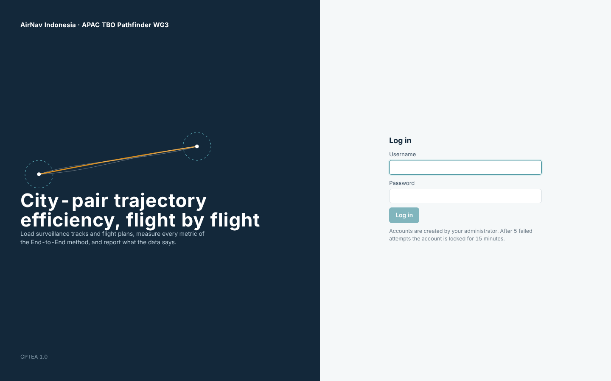

At your first sign-in, and after an administrator resets your password, CPTEA asks you to choose your own password. It must be at least 10 characters long and contain both letters and digits.

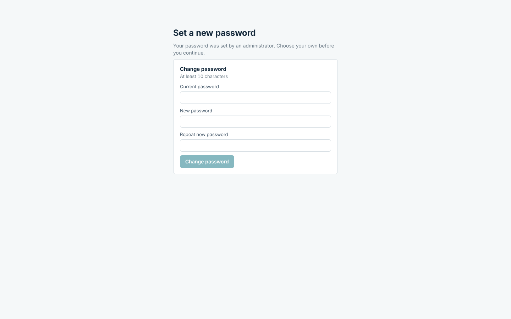

**Session rules.**

- If you are idle for 30 minutes, CPTEA signs you out.
- After 5 wrong passwords in a row, the account is locked for 15 minutes. An administrator can unlock it sooner by resetting the password.
- To change your password later, choose your name at the top right, then **Your account**.

## 2.2 Roles

| Role | What it can do |
|---|---|
| Administrator | Everything an Analyst can do. Also manages users, the system default parameters, administrator-only parameters, airspace imports, the NavEarth refresh and the audit log. Sees every project. |
| Analyst | Creates projects, loads data, edits parameters, runs analyses, edits insights and generates reports. Can open other analysts' projects read-only. |
| Reviewer | Reads the projects shared with them and releases reports that are in review. |
| Viewer | Reads results and downloads reports in the projects shared with them. |

Within a project, the owner can share it with another user at Viewer, Reviewer or Analyst level (see 3.2).

## 2.3 Screen layout

- **Left bar.** Lists the project pages and, for administrators, the administration pages.
- **Project header.** Shows the city pair as a route ribbon from ADEP to ADES, with the project period underneath.
- **Run picker.** Most project pages have one. It chooses which analysis run the page shows, and your choice carries across pages.
- **Chart downloads.** Every chart has **PNG**, **SVG** and **CSV** buttons. CSV gives the numbers behind the chart.
- **Version.** The bottom of the left bar shows the CPTEA version.
- **Map layers.** Every map has a layer button at the top right that switches airways, waypoints, FIR boundaries and TMA boundaries on and off. When the server has no internet access, the maps still show a built-in coastline.

# 3. Projects

## 3.1 Creating a project

On **Projects**, choose **New project**.

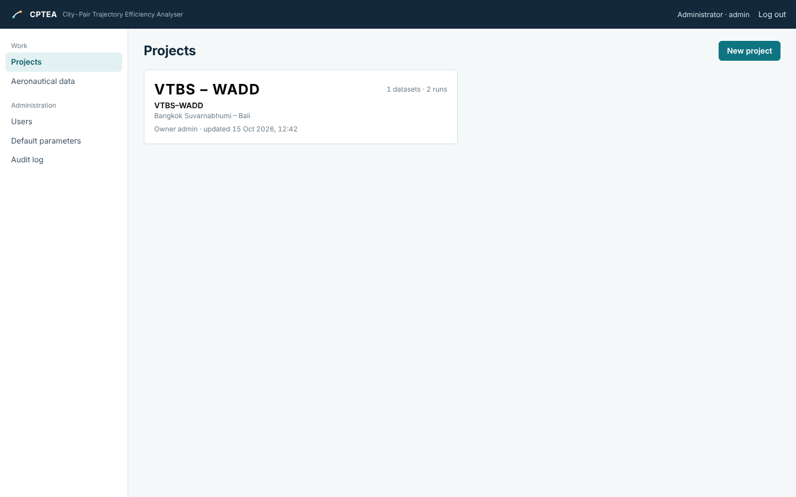

Fill in:

- **Name and description.**
- **ADEP and ADES.** The ICAO codes of the two aerodromes, with their reference coordinates. If you leave the coordinates blank, they are taken from the aeronautical data.
- **Period.** Used for coverage tables and labels. It does not filter the data.
- **Callsigns per direction.** The flight numbers in the study and the direction each one flies. Flights whose callsign is not listed are still loaded. Their direction is then decided by the aerodromes at the start and end of the track.

**Fill in the VTBS–WADD example** enters the reference project (THA431/439 VTBS→WADD, THA432/440 WADD→VTBS).

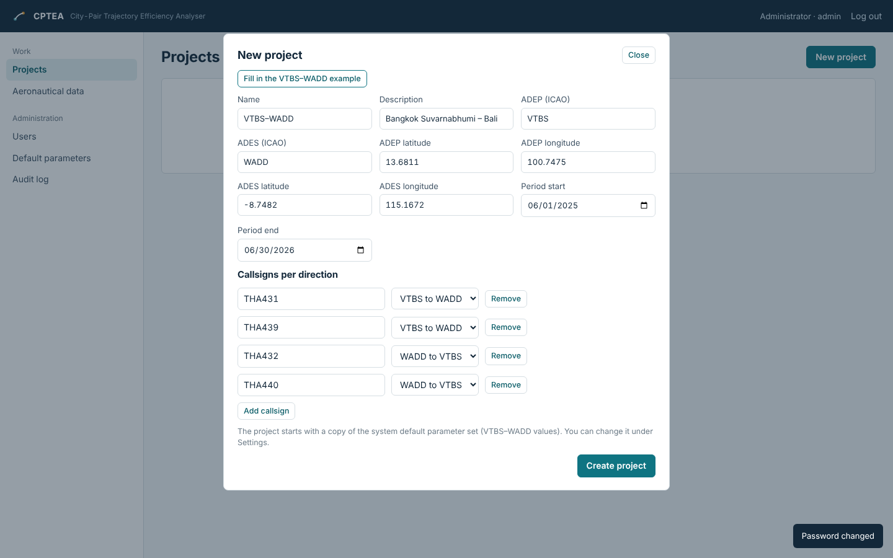

A new project starts with its own copy of the system default parameter set.

## 3.2 Overview and sharing

The **Overview** page has three parts:

- the workflow steps, each linking to its page;
- the project details, with **Edit**, **Share** and **Delete**;
- the latest run's headline numbers.

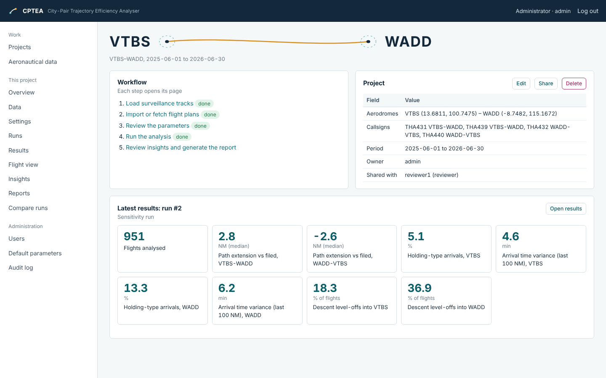

To share the project, choose **Share**, pick a user and an access level, then choose **Share**. To stop sharing, remove the user in the same dialog.

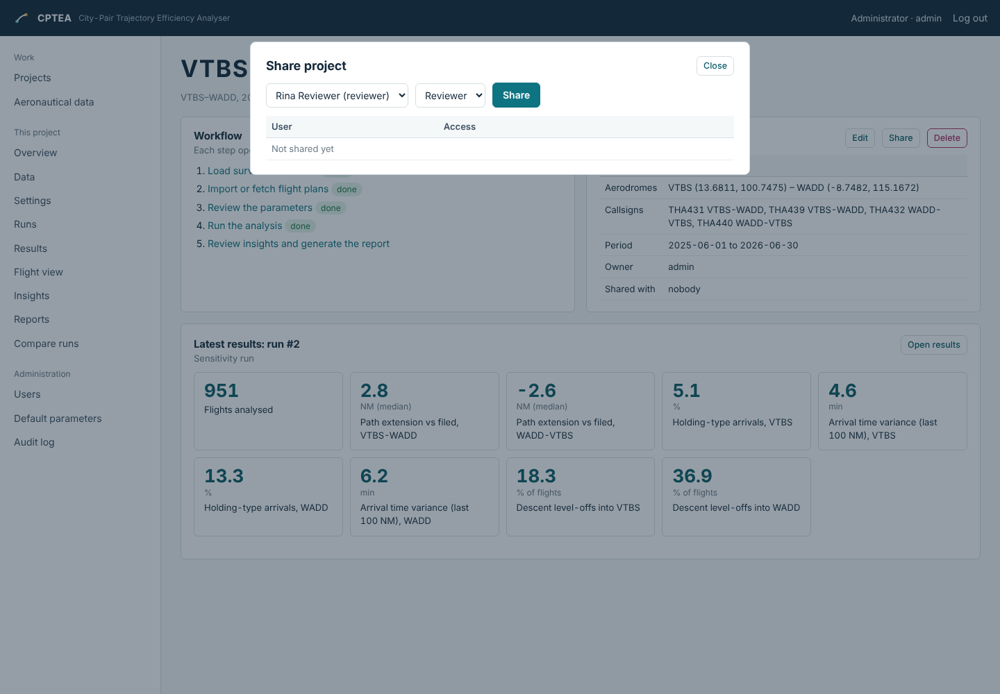

# 4. Loading data

All data loading happens on the **Data** page.

## 4.1 Tracks

Choose **Load tracks**, give the dataset a name, then supply the tracks in one of three ways:

- **Files.** Select individual CSV files, or a ZIP of them.
- **Folder.** Select a whole folder (the FR24 tree `Year/Month/Callsign/*.csv` works as is).
- **Server path.** Type a folder path on the CPTEA server. This is fastest for large archives that are already on the server.

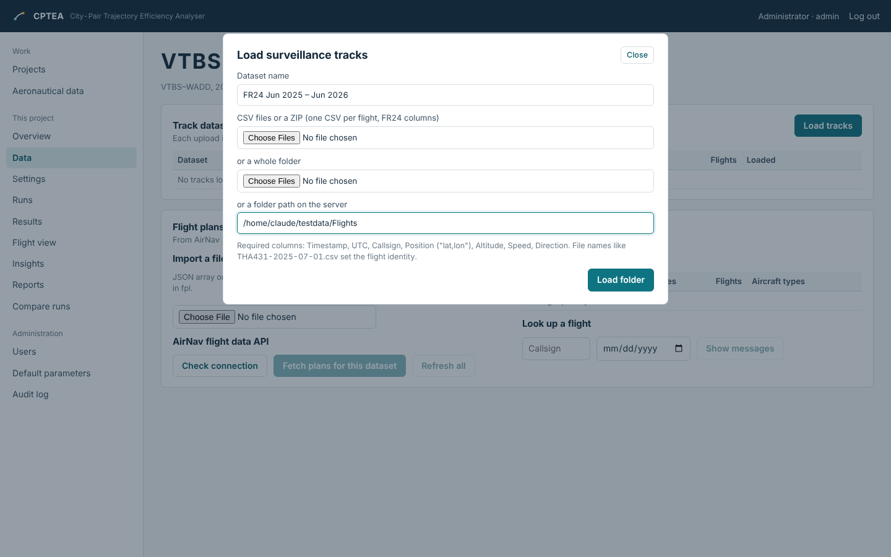

Each CSV holds one flight in Flightradar24 format:

```
Timestamp,UTC,Callsign,Position,Altitude,Speed,Direction
1768808455,2026-01-19T07:40:55Z,THA432,"-8.74542,115.166031",0,0,357
```

Altitude is in feet and speed in knots. A flight is identified as `CALLSIGN-YYYY-MM-DD` using the take-off date (UTC).

Loading runs in the background, so you can leave the page. Each load creates a new, unchangeable **dataset version**. Earlier versions stay available, and the runs made on them stay reproducible.

During loading CPTEA:

- removes physically impossible points (an implied speed above 700 kt, or an altitude jump of more than 3,000 ft in under 10 s);
- checks that each flight is gate-to-gate, meaning its first and last points lie within the airport radius of the expected aerodromes;
- flags data gaps;
- excludes flights shorter than the minimum valid duration.

Choose a dataset to see its quality report:

- flights loaded and included;
- the share of gate-to-gate flights;
- flights with gaps over 300 s and over 600 s;
- a coverage table per callsign and month, with empty months highlighted;
- sampling intervals by altitude band.

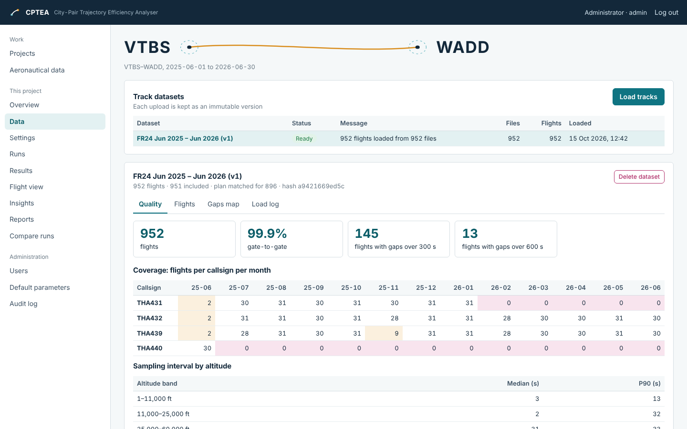

- **Flights tab.** Lists every flight. An Analyst can **Exclude** a flight, which requires a reason, or **Include** it again. Exclusions apply to the next run and are recorded in the audit log.
- **Gaps map tab.** Shows where the airborne gaps are.
- **Load log tab.** Lists the files that could not be read and the reason for each.

## 4.2 Flight plans

CPTEA uses flight plans for the filed route and the filed levels. There are two sources.

**Archive files.** Under **Import a file**, choose a JSON or Parquet file from the AirNav FPL archive. Each record needs:

- `callsign`;
- `dof`, the date of flight;
- the raw ICAO message in `fpl`;
- optionally `id`, `route` and `typeOfAircraft`.

If `dof` is missing, it is read from the `DOF/` field of the message. FPL, CHG and CNL messages are all kept.

**AirNav flight data API.** This source only works when the CPTEA server is on the AirNav VPN.

1. Choose **Check connection** to test the API.
2. Choose **Fetch plans for this dataset** to request the plan for every flight that has none yet, or **Refresh all** to fetch every flight again.
3. To fetch a single flight, use **Fetch plan from API** in the Flight view.

API results are compared with the file plans. Differences in route, level or aircraft type are flagged on the flight.

**Look up a flight** shows every message held for a callsign and date.

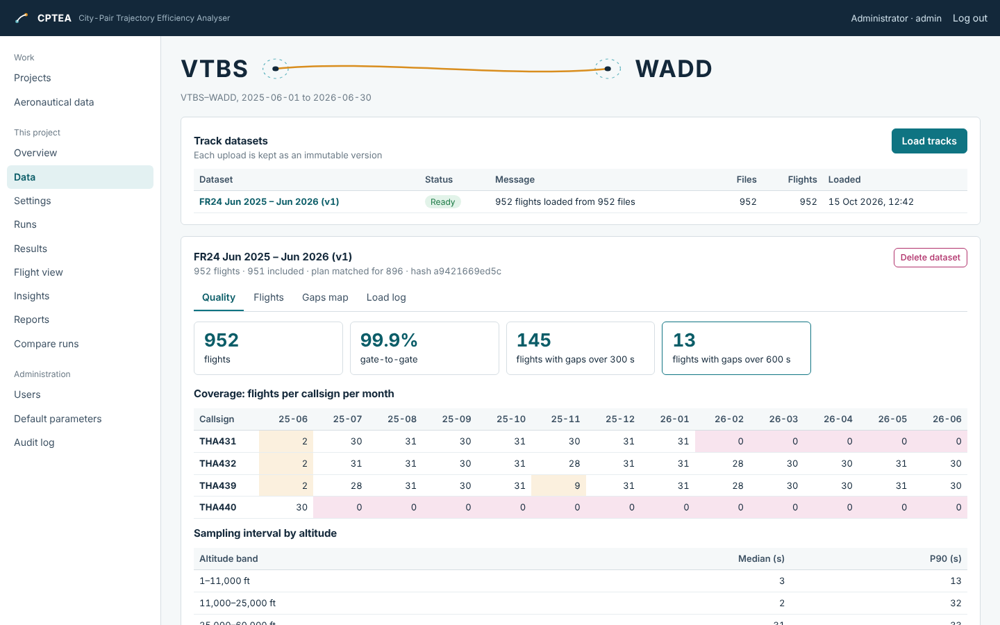

**Which plan is used.** A flight can have several messages. The parameter *Flight plan version used* (FPL-01) decides which one counts:

- the last plan filed before EOBT (the default);
- the first plan filed;
- or the last message received.

A CHG message updates the plan it refers to, and a CNL message cancels it. *Flight plan source* (FPL-03) chooses between file, API or "API, else file".

## 4.3 Aeronautical data

Route expansion turns the filed Item 15 (fixes and airways) into coordinates. The fixes and airways it uses live under **Aeronautical data** in the left bar, and every project shares them.

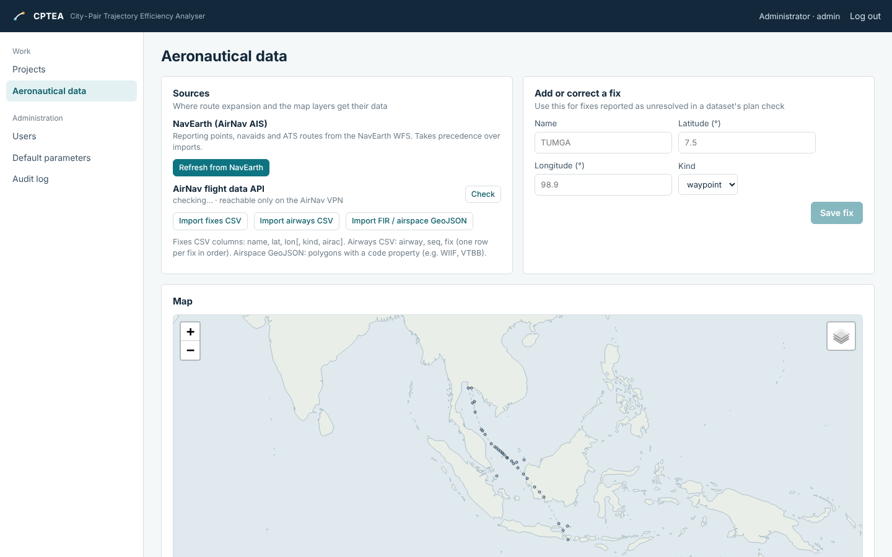

- **NavEarth (AirNav AIS).** The panel at the top of the page shows the WFS address CPTEA loads from. An Administrator chooses **Refresh from NavEarth** to load four layers:
  - reporting points;
  - en-route navaids;
  - ATS routes;
  - TMA polygons.

  NavEarth data takes precedence over imported data. The CPTEA server, not your browser, must be able to reach NavEarth.

  TMA polygons are drawn on every map as **TMA boundaries**; hover over one for its class, limits and approach unit. They are not used for the efficiency-by-FIR metric, which only uses imported FIR boundaries.
- **Fixes CSV** (Analyst). Columns `name, lat, lon` and optionally `kind, airac`.
- **Airways CSV** (Analyst). Columns `airway, seq, fix`, with one row per fix in order.
- **FIR / airspace GeoJSON** (Administrator). Polygons with a `code` property such as WIIF or VTBB. These are used for the efficiency-by-FIR metric.
- **Add or correct a fix.** Use this when a dataset's plan check reports an unresolved fix.

CPTEA ships with the fixes and airways of the VTBS–WADD routes, so the example works without NavEarth access.

**Changing the NavEarth address** (Administrator).

1. In **WFS address**, paste either the GeoServer endpoint (ending in `/ows`) or a full GetFeature link. The default is the AirNav NavEarth link to the `enroute_chart:tma_polygon` layer. From a full link, CPTEA keeps the version and output format, and asks for each layer in turn.
2. If the new server names its layers differently, open **Layer names** and change them. Separate several ATS route layers with commas. Leave a layer empty to skip it.
3. Choose **Test connection**. CPTEA fetches one feature from each layer and shows, per layer, whether it answered and which fields it returned.
4. Choose **Save address**, then **Refresh from NavEarth**.

**Discard changes** abandons unsaved edits. **Restore default** returns to the shipped address and layer names. Every change is recorded in the audit log with the old and new address.

Other users see the address, but only an Administrator can change it.

**Unresolved fixes.**

- A fix that cannot be found at either **end** of a route, such as TUMGA, is skipped, and the route is still used.
- A fix that cannot be found in the **middle** of a route makes that plan unusable for reference-route metrics. Add the fix's coordinates and run the analysis again.

# 5. Parameters

Open **Settings** in the project.

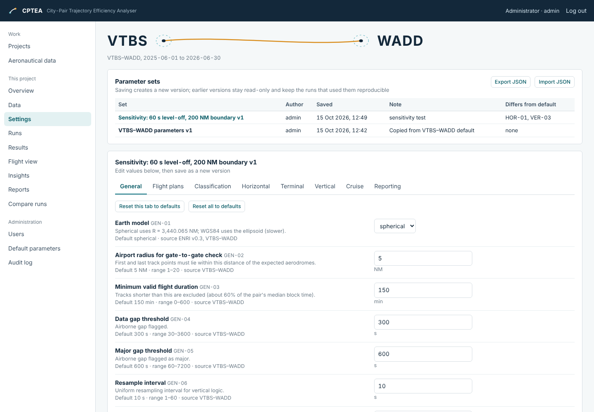

- The upper table lists the project's parameter sets. Saving always creates a **new version**, and older versions are read-only, so a run can always show exactly which values it used.
- The editor below has one tab per step of the method: General, Flight plans, Classification, Horizontal, Terminal, Vertical, Cruise and Reporting.
  - Each parameter shows its default, the allowed range and where the value comes from (ENRI v0.3, CAAS, VTBS–WADD or proposed).
  - Values that differ from the default are highlighted.
  - Values out of range are marked, and they stop the set from being saved.
- **Reset this tab to defaults** and **Reset all to defaults** restore the shipped values.
- Write a short note saying what you changed and why, then choose **Save new version**.
- **Export JSON** and **Import JSON** move a set between projects or servers.
- Parameters marked *administrator only* can only be changed by an Administrator.

**Cut lines for route classification.** The map under the editor shows the latest run's tracks and the cut lines (CLU-02).

- Click the map to add a cut line; click a line to remove it.
- Keep every cut line outside the classification clip radius around both aerodromes (CLU-01, 100 NM by default), otherwise tracks never cross it.

The full list of parameters and their VTBS–WADD defaults is in Appendix A.

# 6. Running an analysis

On **Runs**, choose the dataset, the parameter set and optionally a name, then choose **Start run**.

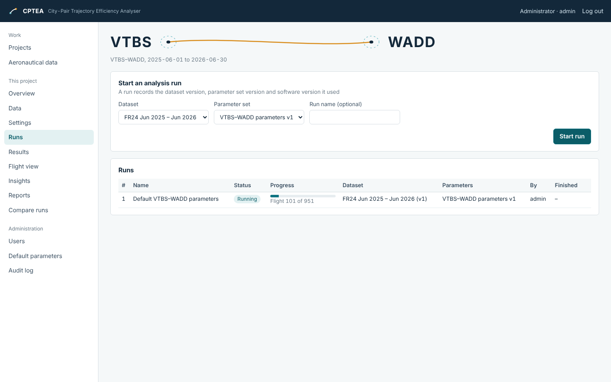

The run works through these steps, and its progress is shown as it goes:

1. Build the plans.
2. Classify the routes.
3. Compute the per-flight metrics.
4. Aggregate the results.
5. Draft the insights.

A year of one city pair (about 950 flights) takes about one minute.

When a run is done:

- **Results** opens it.
- **Excel** and **CSV** download the per-flight results table.
- **Delete** removes the run, including its insights and reports.

If the server restarts during a run, that run is marked as failed and you can start it again.

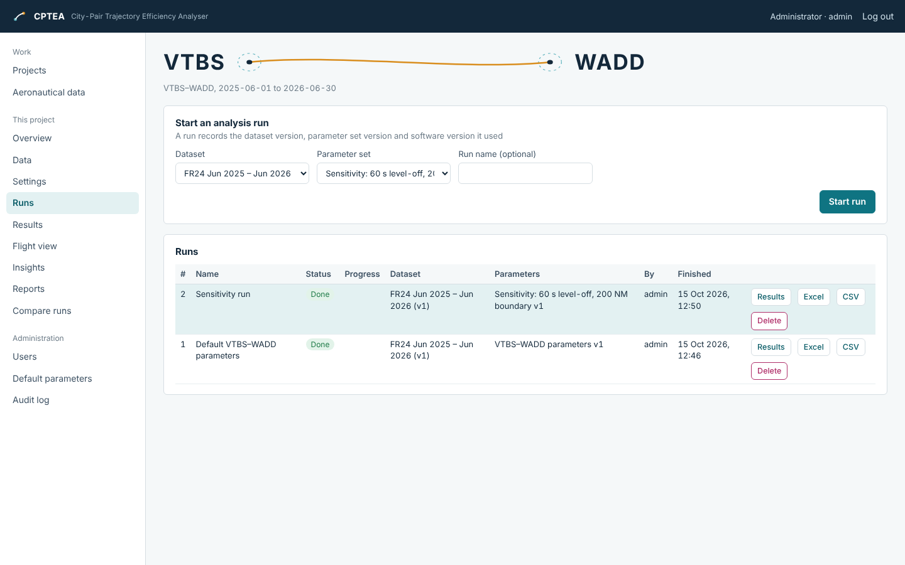

# 7. Results

**Results** shows the selected run for all included flights.

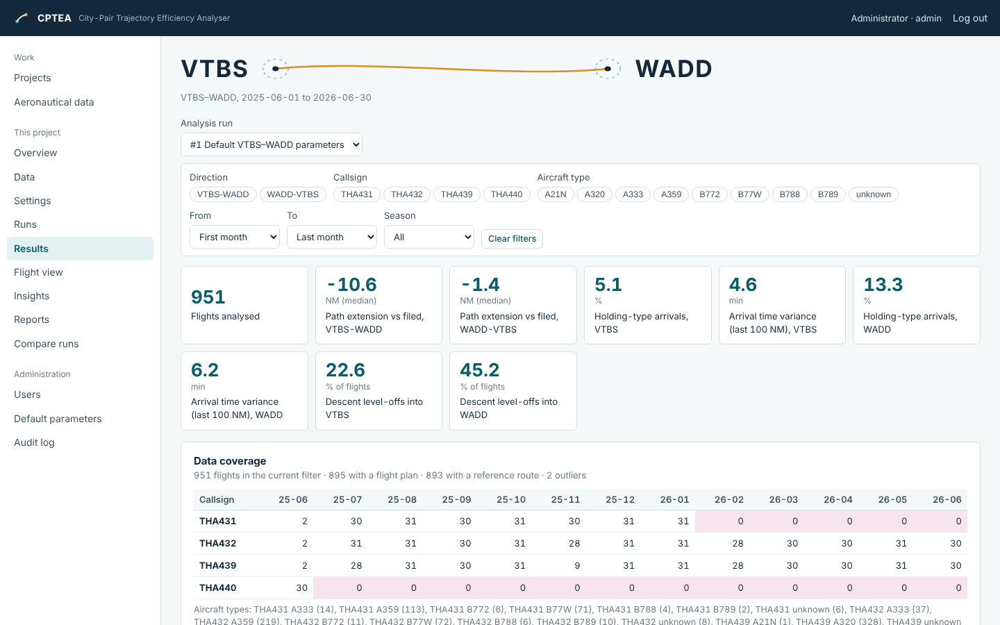

## 7.1 Filters

The filter bar stays at the top as you scroll. It filters by:

- direction;
- callsign;
- aircraft type;
- month range;
- season (December–February, March–May, June–August or September–November).

Every number, chart and table on the page is recomputed for the filtered flights. **Clear filters** returns to all flights. The report generator can reuse these filters (see 10).

## 7.2 Headline numbers and coverage

The headline cards give the key figures of the method:

- path extension against the filed route at the en-route boundary, per direction;
- holding-type arrivals and arrival time variance per destination;
- the share of flights with a descent level-off.

The coverage table shows flights per callsign per month, and lists the aircraft types per callsign.

## 7.3 Track density and route classification

The map draws every track, coloured by direction (or by cluster or aircraft type), with outliers in magenta. Click a track to open it in the Flight view.

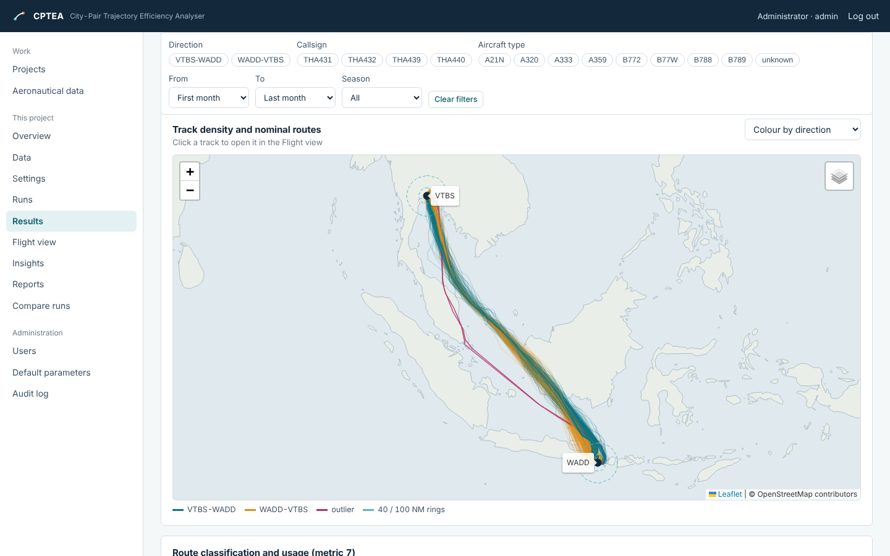

**Route classification (metric 7)** groups the tracks per direction:

1. CPTEA records where each track crosses the cut lines.
2. It clusters those crossings with k-means.
3. A track far from its cluster is marked as an outlier, if both of these hold:
   - it is more than CLU-05 × MAD from the centre;
   - it is at least CLU-05b (1.5°) away.
4. A cluster with fewer than CLU-04 % of flights is reported as a contingency route.

The table and monthly chart show how each route is used over time.

## 7.4 Horizontal efficiency (metrics 1–6)

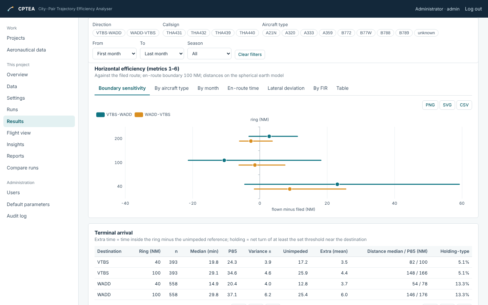

Path extension is the flown distance between the boundary rings minus the length of the filed route between the same rings. A negative value means flights fly shorter than filed, usually because of tactical directs.

| Tab | Shows |
|---|---|
| Boundary sensitivity | Median and P15–P85 at each boundary radius (40, 100 and 200 NM by default), so you can see how the result depends on where the en-route phase is cut |
| By aircraft type / By month | The same metric split by aircraft type or by month |
| En-route time | Median time between the rings with its P15–P85 band, and the variance (half of P85 − P15) |
| Lateral deviation | Distance from the filed route along the route |
| By FIR | Path extension inside each FIR (needs FIR boundaries imported) |
| Table | All the numbers |

## 7.5 Terminal arrival

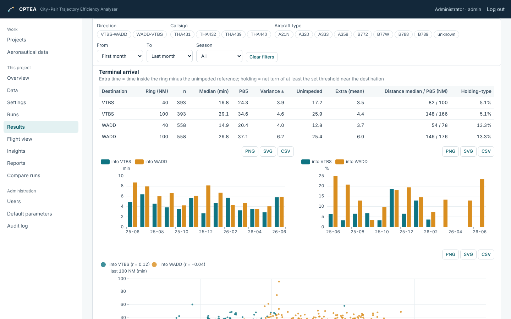

For each destination and ring radius (40 and 100 NM), the table gives:

- the time spent inside the ring: median, P85 and variance;
- the unimpeded reference time;
- the extra time compared with that reference;
- the distance flown;
- the share of **holding-type** arrivals, meaning flights whose net turn near the destination reaches the holding threshold (TER-03).

The charts show extra time and holding share by month, and plot en-route time against arrival time. A correlation near zero means delay is absorbed in the terminal area rather than upstream.

## 7.6 Cruise vertical efficiency (metric 8)

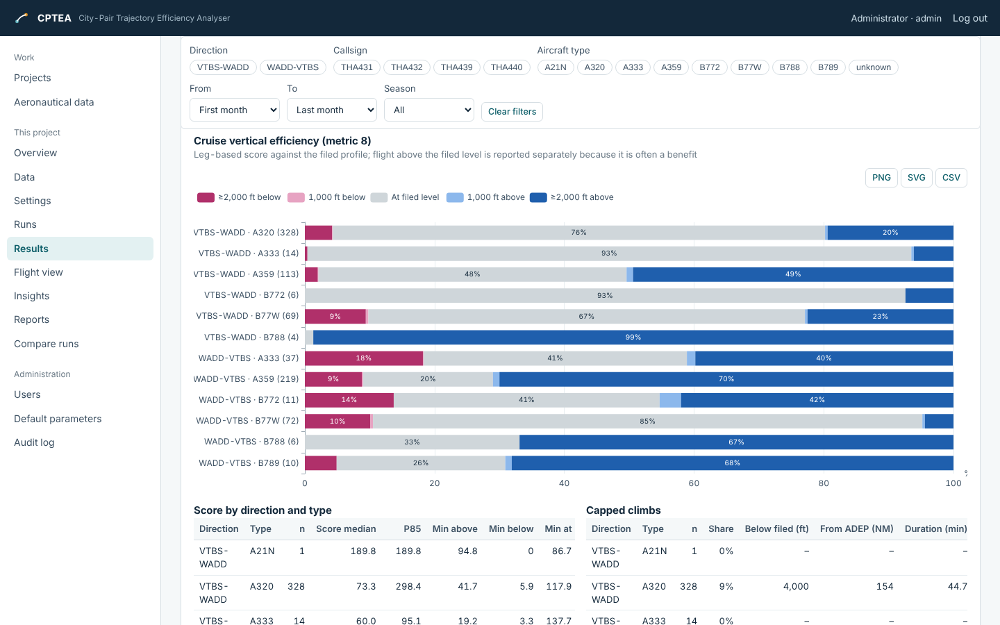

This section uses ENRI's leg-based method.

1. Each cruise waypoint of the filed route is matched to the track at its closest point of approach.
2. The flown level at each waypoint is compared with the filed level for that leg, and the difference is classified as:
   - at the filed level;
   - 1,000 ft above or below;
   - 2,000 ft or more above or below.
3. The bars show these classes per direction and aircraft type.
4. The **score** adds the level differences weighted by time.
   - Flight below the filed level is the inefficiency.
   - Flight above it is reported separately, because it is often a benefit.

The section also contains:

- **Capped climbs.** Flights that level off below the filed level before reaching cruise, with how far below, where, and for how long.
- **Planned against flown level changes.**
  - Each flown level change is matched to the filed level change at the nearest waypoint, within CRU-08 NM. Changes found within that distance are drawn in green on the map.
  - Changes that are filed but happen elsewhere are drawn in amber.
  - Changes that are not in the plan at all are drawn in ink.

## 7.7 Climb and descent level-offs (metrics 9–10)

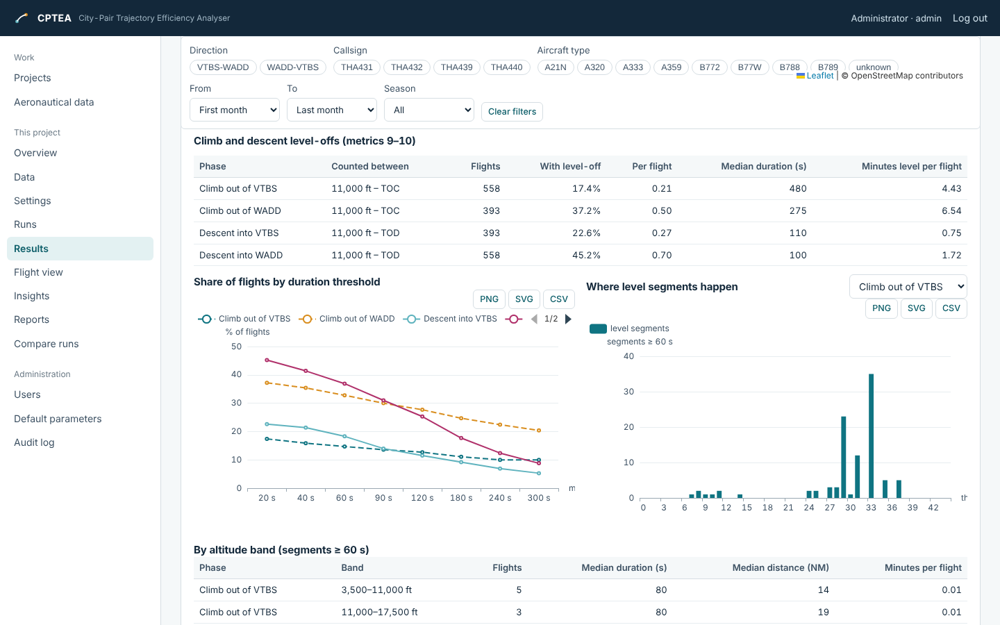

A level-off is a segment with a vertical rate below VER-02 (5 ft/s) that lasts at least VER-03 (20 s). Level-offs are counted between 11,000 ft and the top of climb, and between the top of descent and 11,000 ft.

- The table gives, per phase and aerodrome:
  - the share of flights with at least one level-off;
  - level-offs per flight;
  - the median duration;
  - level time per flight.
- **Share of flights by duration threshold** shows how the result changes with the minimum duration (20 s to 300 s). The method is very sensitive to this choice.
- **Where level segments happen** is a histogram by altitude.
- **By altitude band** splits the level time into the bands of VER-09.

## 7.8 Flights table and exports

At the bottom of the page, the flights table lists every flight with its main metrics. Click a row to open the flight.

The Runs page has the **Excel** export. It holds:

- the per-flight results;
- one sheet for each results table (extension, en-route time, terminal, cruise, level-offs);
- the level segments, level changes and waypoint checks of every flight;
- the parameter values of the run.

# 8. Flight view

The Flight view shows one trajectory against its flight plan. You can reach it in three ways:

- type a flight ID such as `THA431-2025-08-14`;
- use **Previous** and **Next**;
- click a track or a row on the Results page.

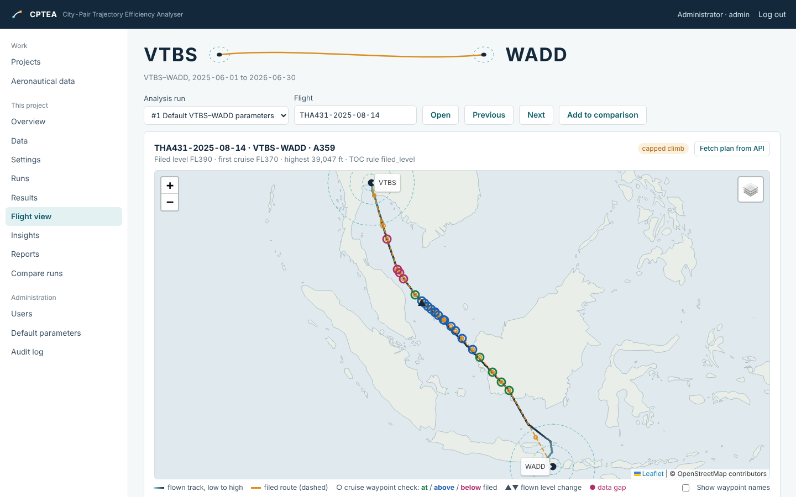

**The header** shows:

- direction, aircraft type, the filed level, the first cruise level and the highest level;
- flags such as *outlier*, *holding-type turns*, *capped climb*, *no flight plan* and data-quality flags.

**The map** shows:

- the flown track, coloured from light (low) to dark (high);
- the filed route as an amber dashed line;
- the cruise waypoint checks as rings (green: at the filed level, blue: above, magenta: below);
- flown level changes (▲ climb, ▼ descent);
- data gaps;
- the boundary rings around both aerodromes.

Hover over any symbol for details. **Show waypoint names** labels the filed waypoints. Drag **Playback** to follow the flight.

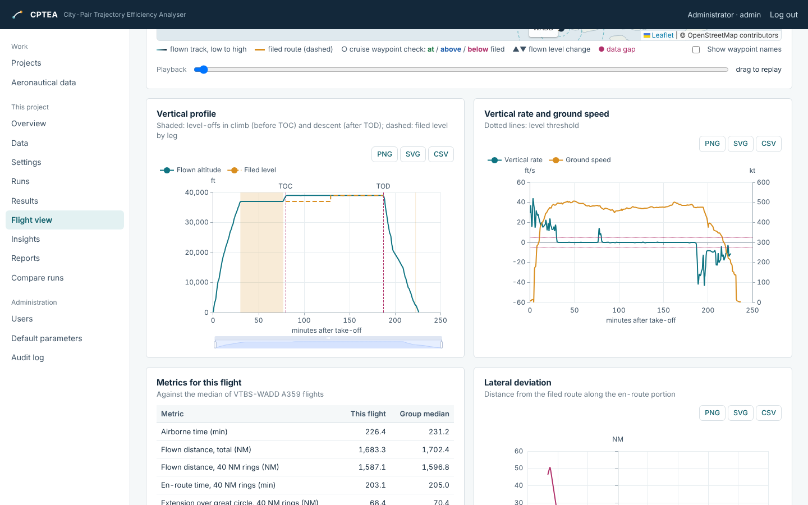

**Vertical profile.** The flown altitude over time, with:

- the filed level by leg as a dashed line;
- top of climb (TOC) and top of descent (TOD);
- shaded level-offs in climb and descent.

**Vertical rate and ground speed.** Dotted lines mark the level threshold.

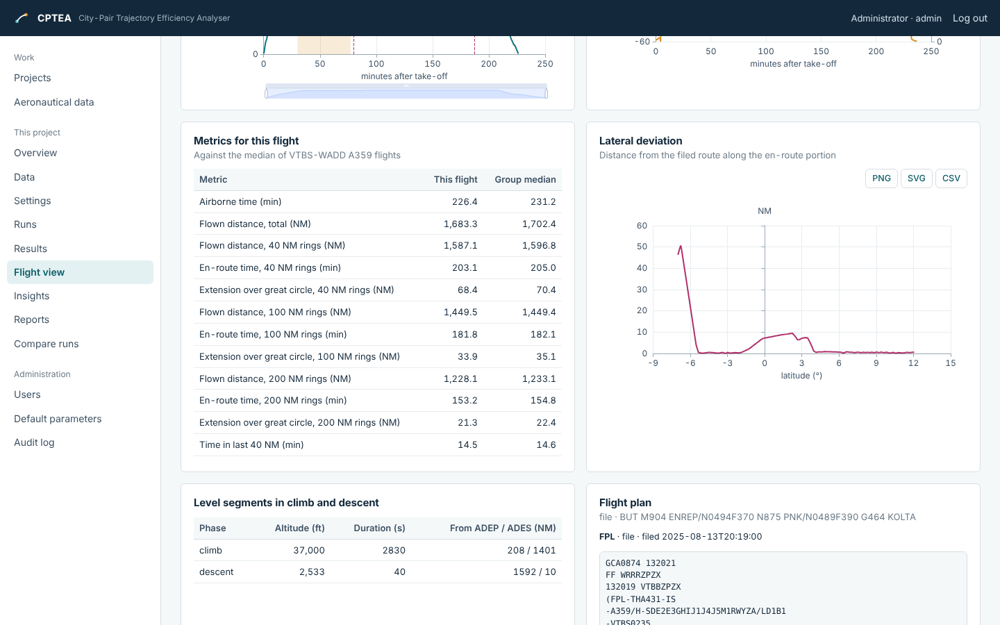

**Metrics for this flight.** Every metric of the flight next to the median of flights of the same direction and aircraft type.

**Lateral deviation.** Distance from the filed route along the en-route part of the flight.

**Level segments.** Each level-off in climb and descent with its altitude, duration and distances.

**Flight plan.** The filed route used, with any fixes that could not be resolved, and every message held for the flight (file and API) with the API cross-check flags.

**Comparison.** **Add to comparison** keeps the flight. Up to 5 flights are drawn together on the map and the profile.

# 9. Insights

At the end of each run, CPTEA drafts insights from the results using fixed rules (Appendix B). Each insight states the numbers it is based on, and **Open chart** goes to the chart that supports it. The thresholds that trigger each rule are in the Reporting parameters (REP-02).

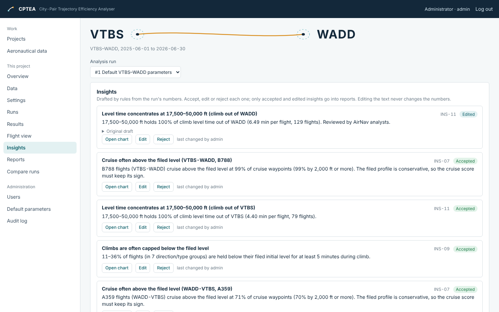

An Analyst reviews each insight:

- **Accept** keeps the insight as drafted.
- **Edit** rewrites the wording. The original draft stays visible under *Original draft*. Editing never changes the numbers.
- **Reject** keeps the insight out of reports.

Below the insights, analysts can add insights or recommendations of their own.

Only accepted and edited insights go into reports, unless *Include insights not yet accepted* is ticked when the report is generated.

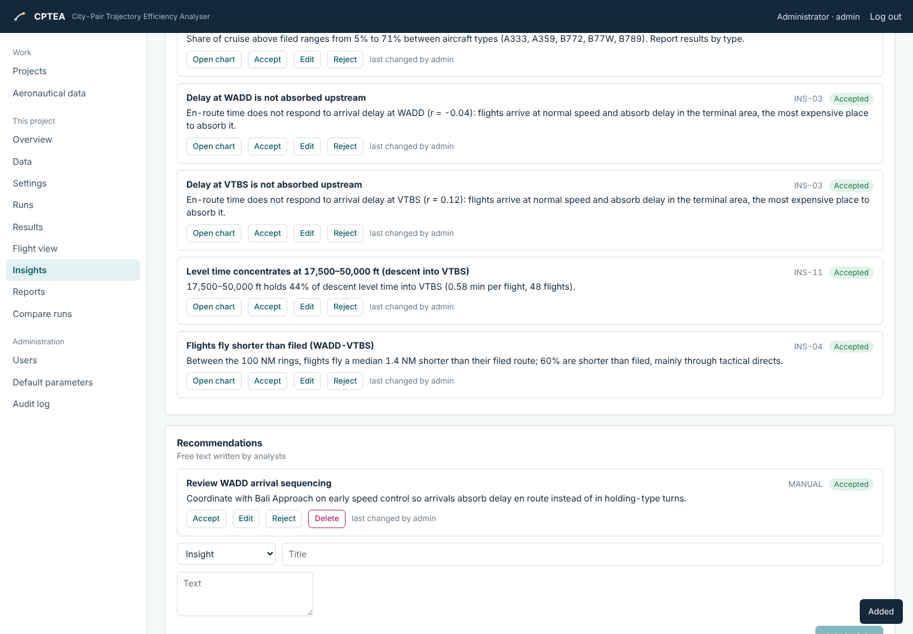

# 10. Reports

On **Reports**, an Analyst:

1. Chooses the run.
2. Sets the title, the authors and, optionally, a logo.
3. Picks the sections:
   - executive summary;
   - data and coverage;
   - method and parameters;
   - route classification;
   - horizontal efficiency;
   - terminal arrival;
   - cruise vertical efficiency;
   - climb and descent level-offs;
   - insights and recommendations;
   - annex.
4. Picks the formats: **PDF**, **Word** (both full reports) and a **PowerPoint** summary.
5. Chooses **Generate report**.

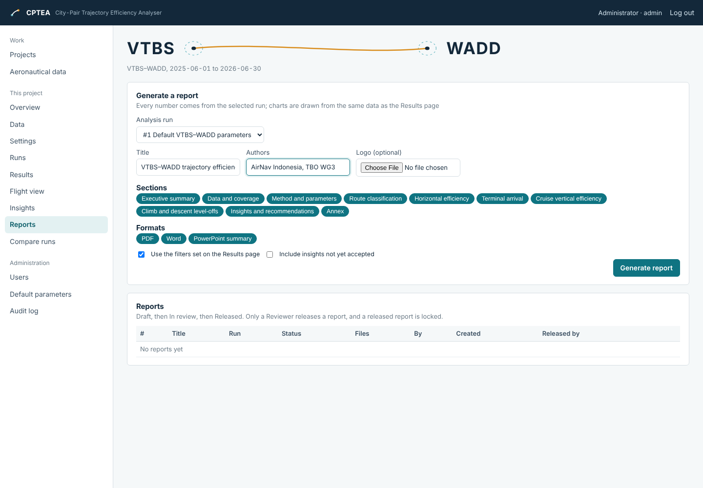

With *Use the filters set on the Results page* ticked, the report covers the same filtered flights you were looking at. All numbers and charts come from the selected run, so they match the Results page exactly.

The annex lists:

- every parameter value with its source;
- the excluded flights with their reasons;
- the unresolved flight-plan fixes;
- a glossary.

**Review and release.**

| Status | Who moves it on | Meaning |
|---|---|---|
| Draft | Analyst: **Send for review** | Still being prepared |
| In review | Reviewer: **Release**, or **Back to draft** | Waiting for review |
| Released | — | Final. The report is locked and records who released it |

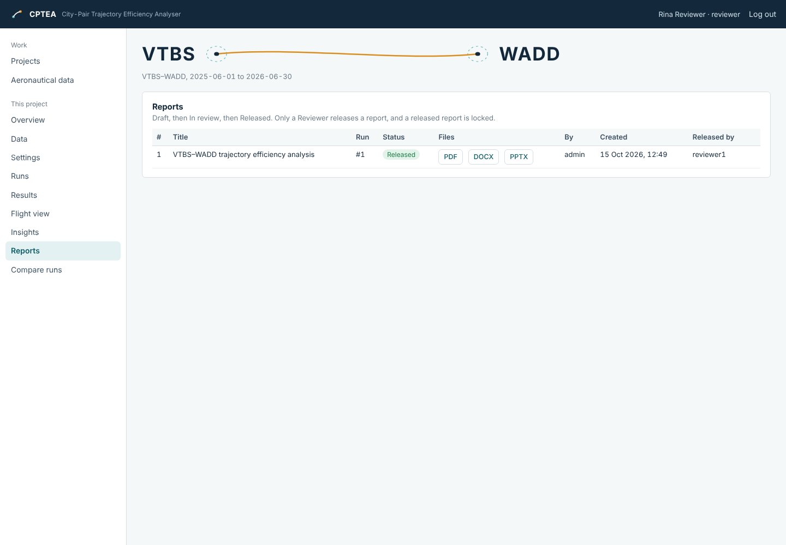

# 11. Comparing runs

**Compare runs** puts two finished runs side by side. For example, it can compare the default parameters with a sensitivity case such as a 60 s level-off threshold and a 200 NM en-route boundary. It lists:

- the headline metrics of both runs and their difference;
- the parameters that differ between them.

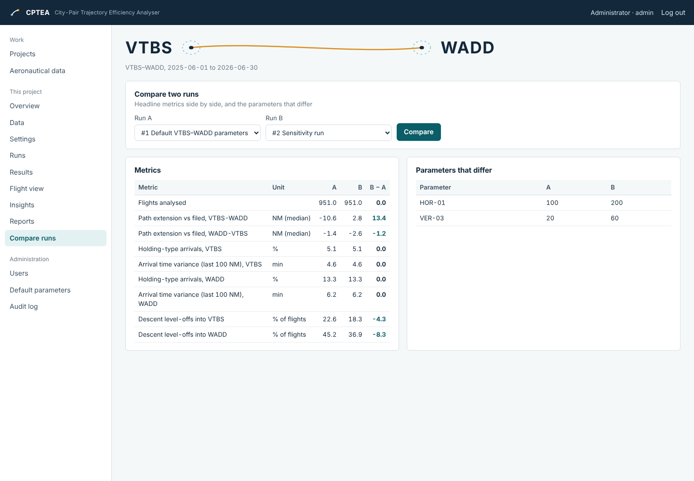

# 12. Administration

## 12.1 Users

**Users** lists every account with its role, status and last sign-in.

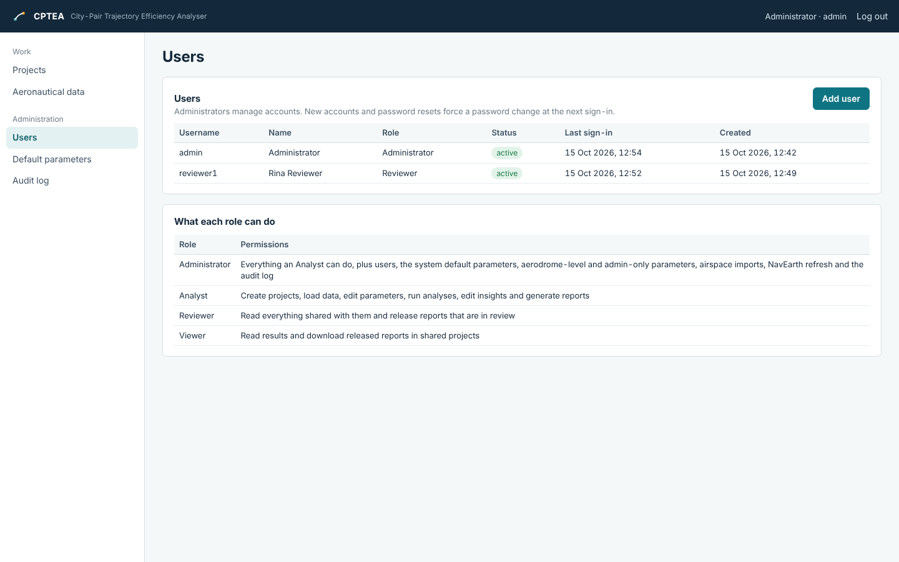

- **Add user** creates an account with a temporary password. The user must change it at first sign-in.
- Choose a user to:
  - change their name or role;
  - reset their password (this also unlocks the account);
  - deactivate the account.
- You cannot deactivate your own account.

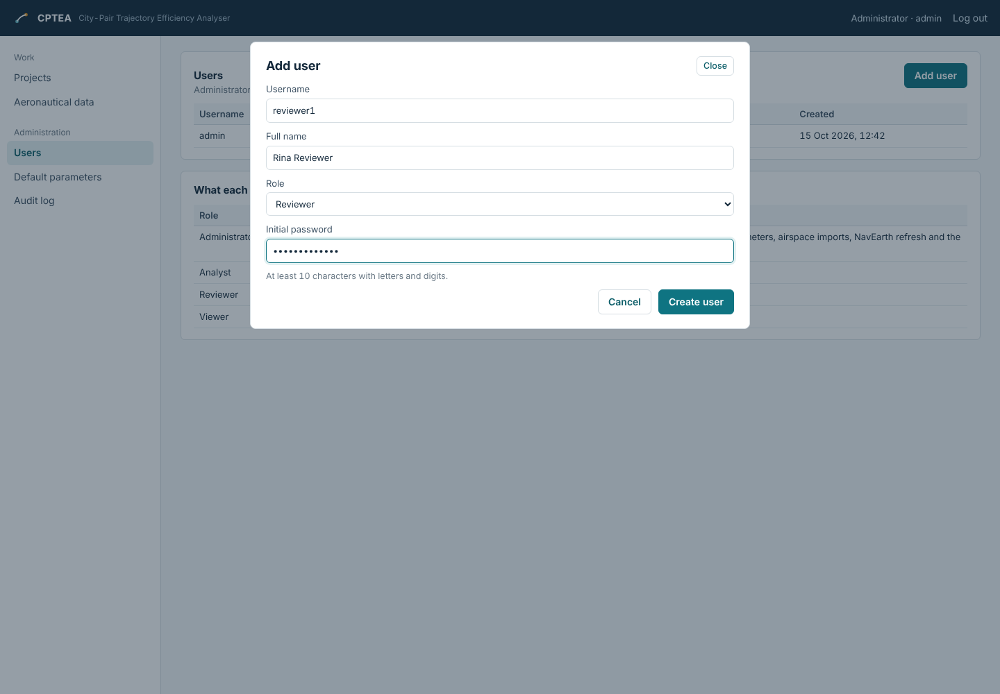

## 12.2 Default parameters

**Default parameters** edits the system-wide set that new projects copy. Existing projects keep their own sets. Each save creates a new version. **Restore shipped VTBS–WADD values** returns to the delivered defaults.

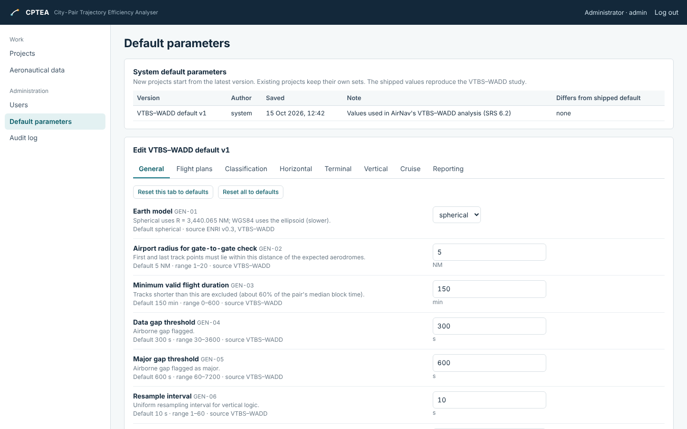

## 12.3 Audit log

The **Audit log** records these events, with the user and time of each:

- sign-ins and failed sign-ins;
- user changes;
- data loads, flight exclusions, plan fetches and AIS imports;
- parameter changes, with the changed values;
- runs;
- insight edits and report status changes.

Entries cannot be changed. Filter by action or user, or choose **Download CSV**.

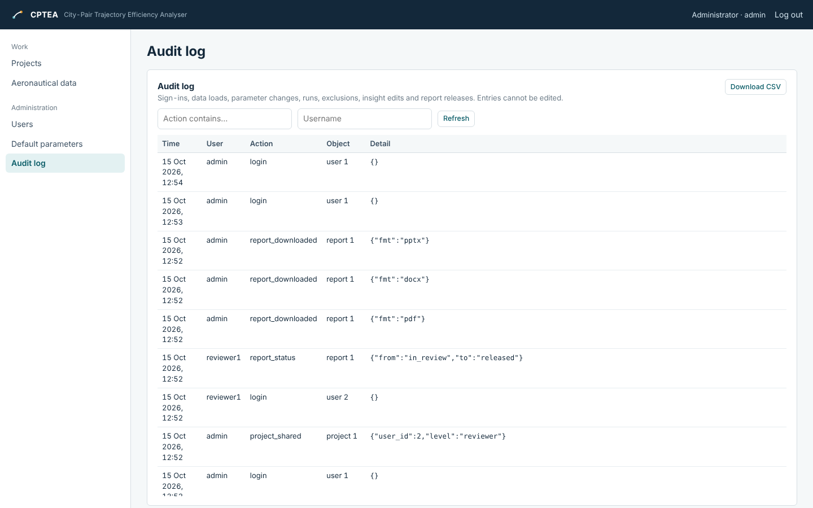

# 13. Troubleshooting

| What you see | What to do |
|---|---|
| "AirNav flight data API not reachable" | The CPTEA server is not on the AirNav VPN. Connect the server to the VPN and choose **Check connection** again, or import archive files instead. |
| "NavEarth not reachable from the server" | The server cannot reach the WFS address. Choose **Test connection** to see which layers fail. Check the address and the server's network or VPN access. Meanwhile, use the shipped VTBS–WADD data, or import fixes and airways as CSV. |
| A feature described in this manual is missing, or the left bar warns that "the web interface is older than the server" | The interface was not rebuilt after an update. Ask the administrator to rebuild it (see "Updating CPTEA" in the README), then reload the page. |
| Test connection: "The server did not return GeoJSON" | The layer name does not exist on that server, or the address is not a WFS endpoint. Correct it under **Layer names**. |
| Many flights show *plan not expandable* | A fix in the middle of their routes is unknown. The dataset's plan check names the fixes. Add them under **Aeronautical data** and run the analysis again. |
| Route classification shows no crossings | A cut line lies inside the clip radius around an aerodrome (CLU-01). Move the cut line or reduce the radius. |
| Too many outliers | Raise CLU-05 or CLU-05b. Tactical directs move tracks a little, but they are not separate routes. |
| A month is missing in the charts | Check the coverage table on the Data page. Months without data appear as 0 and are highlighted. |
| Maps show only a coastline | The browser cannot reach the map tile server. All data layers still work. Ask the administrator to set `CPTEA_TILE_URL` to a tile server you can reach. |
| Signed out unexpectedly | You were idle for 30 minutes. Sign in again; your runs and settings are kept. |
| "Account locked" | Wait 15 minutes, or ask an administrator to reset your password. |
